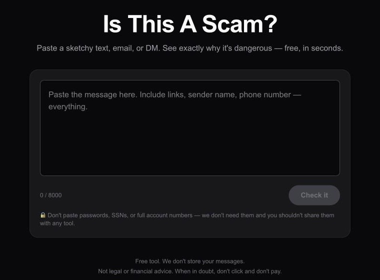
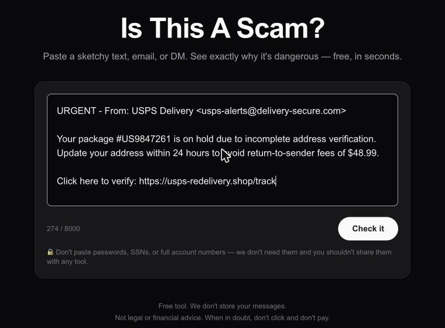

# IsThisAScam — case study

**Live product:** [isthisascam.fyi](https://isthisascam.fyi)
**What this repo is:** a write-up of how the site is built, with product screenshots. The application source is private.

Paste a suspicious text, email, or DM. The site returns a plain-language verdict, the red flags it found, and what to do next.

| 1. Paste | 2. Check | 3. Result |
|---|---|---|
|  |  |  |

*The example message is a made-up USPS redelivery scam.*

## What it does

- **Input:** pasted message text, 5–8,000 characters. There is no signup.
- **Output:**
  - a verdict: `scam`, `likely_scam`, `suspicious` (shown as "Verify Directly"), `likely_safe`, or `safe`
  - a 0–100 risk score (described in the schema, not range-enforced) and a one-line headline
  - red flags and green flags
  - recommended actions and the likely scam type and tactics
- **Guides:** 10 standalone pages on common scams (USPS and bank texts, PayPal invoices, Marketplace, job offers, wrong-number texts, romance, crypto, suspicious links, and how to report a scam). The reporting guide points to the FTC (reportfraud.ftc.gov) and the FBI's IC3 (ic3.gov), and the other guides link to it.

## Stack

| Area | Choice | Why |
|---|---|---|
| Framework | Next.js 16 (App Router), React 19, TypeScript (strict) | Server-rendered guide pages for search, plus an API route in the same deploy |
| Styling | Tailwind CSS 4 | |
| Analysis | Google Gemini (`gemini-2.5-flash`) with a JSON `responseSchema` | Low latency and cost per check; the schema forces a fixed output shape |
| Rate limiting | Upstash Redis + `@upstash/ratelimit` | Serverless-friendly; no connection pooling |
| Hosting | Vercel, with Vercel Analytics | |

## How a check works

```
browser ──POST /api/check──▶ rate limit (Redis) ──▶ validate length ──▶ Gemini
                                   │ Redis down?                          │
                                   └──▶ 503, no model call    JSON schema │
browser ◀──── verdict / flags / actions (rendered by React) ◀─────────────┘
```

1. **Rate limit per IP:** 10 per minute and 100 per day. Over-limit requests get `429` with `Retry-After`.
2. **Server-side length validation.** The browser enforces the same `maxLength`, but the server doesn't trust it.
3. **One model call.** A system prompt describes scam signals, including sender-name vs. domain mismatches, lookalike domains, urgency, and payment method. It also tells the model to stay calibrated ("never inflate risk") and to write for non-technical readers. The user's text is placed inside `"""` delimiters.
4. **Structured output.** The response must match a JSON schema with a fixed verdict enum, so the UI never has to parse free text.

## Safety-minded behavior (as implemented)

- **Fails closed.** If Redis is unavailable, the API returns 503 instead of calling the model without a rate limit. Other limiter errors also stop before the model call. Redis calls have a 2.5 s timeout and a single retry. An outage therefore can't turn into unmetered model spend.
- **No server-side URL fetching.** Links in pasted messages are analysed as text only, so there is no SSRF surface.
- **Message text is not stored** by the application; the check route writes nothing about the message to Redis or a database.
- **Honest UI copy.**
  - Under the input: "don't paste passwords".
  - On every result: "Automated read… can be wrong in both directions".
  - In the footer: not legal, financial, or security advice.
  - The FAQ says a "safe" verdict is not a guarantee.
- **Waitlist form:** explicit opt-in checkbox (unticked by default), server-side email validation, and its own tighter rate limit.

## SEO and content

- Dynamic `sitemap.ts` generated from a single guide registry, and `robots.ts` blocking `/api/`
- Per-page titles, descriptions, and canonical URLs; site-wide Open Graph and Twitter tags
- A generated 1200×630 Open Graph image
- JSON-LD: `WebSite` and `WebApplication` on the home page, and `FAQPage` generated from the same array that renders the visible FAQ (so the markup can't drift from the content)
- 10 guide pages, internally cross-linked

## Tradeoffs and known limitations

- **One LLM call, no second source.** There is no URL-reputation lookup and no rules engine to cross-check the model. The product is a second opinion, and the copy says so.
- **Prompt-injection resistance comes from structure, not a dedicated defense.** Output is constrained by schema and enum, and rendering is escaped. A message written to steer the model could still bias the verdict.
- **Submitted text goes to the model provider.** The site does not store it, but the model provider processes it.
- **Rate limiting trusts the first `X-Forwarded-For` value** and uses Upstash analytics, which records IP identifiers.

## What I would improve next

- Stop returning the raw error message in the check route's 500 response; log it server-side instead.
- Add a privacy policy page that states exactly what is processed where, including the model provider and IP-based rate limiting.
- Add an eval set: labelled scam and legitimate messages, run on every prompt change, tracking false-positive and false-negative rates.
- Add unit tests for the API route (validation, rate-limit and fail-closed paths) and CI.
- Add an explicit instruction and test cases for messages that try to address the model directly.

---
*Application source is private. Happy to walk through it in an interview.*
